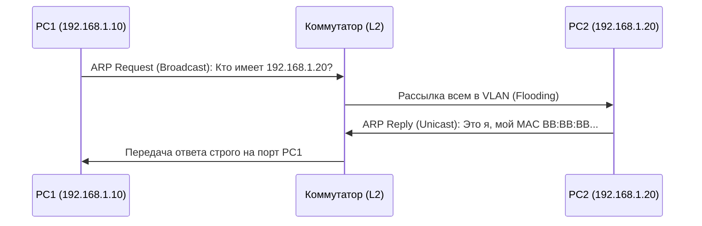

# 03. Коммутация, MAC, ARP и VLAN

Теги: #theory #network #l2 #switching #mac #arp #vlan #lacp #base

## Суть простыми словами
**Коммутация (Switching)** — это передача кадров данных между устройствами внутри одной локальной сети на канальном уровне ([[01. Модели OSI и TCP-IP|L2]]). Главным устройством здесь выступает **коммутатор (Switch)**, который ориентируется по физическим **MAC-адресам**, а не по IP.

---

## MAC-адрес и таблица коммутации (MAC Address Table)
* **MAC-адрес** — уникальный 48-битный (6 байт) физический адрес сетевой карты, записанный в шестнадцатеричном виде (например, `00:1A:2B:3C:4D:5E`).
  * **Первые 3 байта (OUI):** Код производителя сетевой карты (Cisco, Intel, Huawei и т.д.).
  * **Последние 3 байта:** Уникальный серийный номер устройства.
* **Широковещательный MAC (Broadcast):** `FF:FF:FF:FF:FF:FF` — кадр с таким адресом получателя коммутатор обязан разослать во все активные порты (кроме порта-источника).

### Как коммутатор принимает решения (Алгоритм L2)
Коммутатор хранит в оперативной памяти **таблицу MAC-адресов (CAM-таблицу)** с привязкой «MAC-адрес — Номер порта — VLAN» (время жизни записи по умолчанию — **300 секунд**):

1. **Обучение (Learning):** Получив кадр на порт, коммутатор смотрит на **MAC-источника** и записывает его в таблицу за этим портом.
2. **Продвижение (Forwarding):** Смотрит на **MAC-получателя**:
   * Если адрес **есть** в таблице — отправляет кадр строго в нужный порт (Unicast).
   * Если адреса **нет** в таблице (Unknown Unicast) или это Broadcast (`FF:FF:FF:FF:FF:FF`) — рассылает кадр во все порты этого VLAN, кроме входящего (**Flooding**).

---

## Протокол ARP (Address Resolution Protocol)
**ARP** связывает логический [[02. IPv4-адресация и сабнеттинг|IP-адрес]] (L3) с физическим MAC-адресом (L2). Без знания MAC-адреса получателя компьютер не сможет сформировать Ethernet-кадр.

* **ARP-кэш (ARP Table):** Полученную связку «IP — MAC» устройство запоминает в оперативной памяти (в Linux обычно на 60–300 секунд, в Cisco — 4 часа), чтобы не спрашивать каждый раз заново.
* **Gratuitous ARP (GARP):** Специальный ARP-запрос устройства к самому себе («Кто имеет мой же IP?»). Используется при запуске сети для обнаружения **конфликта IP-адресов** и при переключении резервных роутеров (VRRP/HSRP).

---

## Технология VLAN (Virtual LAN — IEEE 802.1Q)
**VLAN** позволяет логически разделить один физический коммутатор на несколько изолированных виртуальных сетей (широковещательных доменов). Устройства из разных VLAN не видят друг друга напрямую без маршрутизатора (L3).

### Типы портов на коммутаторе

| Тип порта | Назначение | Работа с тегами 802.1Q | Куда подключается |
| :--- | :--- | :--- | :--- |
| **Access** | Принадлежит строго **одному** VLAN | Отправляет и принимает обычный **нетегированный** трафик (Untagged) | Компьютеры, серверы, принтеры, IP-камеры |
| **Trunk** | Передает трафик **множества** VLAN одновременно | Добавляет в кадр 4-байтный **тег (VLAN ID)** (Tagged), чтобы соседний свитч понял, чей это трафик | Другие коммутаторы, маршрутизаторы (Router-on-a-Stick), гипервизоры |

* **Native VLAN (VLAN 1 по умолчанию):** Единственный VLAN в Trunk-порту, трафик которого передается **без тега**. В целях безопасности в продакшене Native VLAN меняют на неиспользуемый номер (например, `999`) и не используют `VLAN 1`.
* **Диапазон номеров VLAN:** Всего доступно 4096 значений (`0` и `4095` зарезервированы, рабочие — от `1` до `4094`).

---

## Агрегация каналов (EtherChannel / LACP) и обнаружение соседей (LLDP/CDP)
* **EtherChannel / LACP (IEEE 802.3ad):** Объединение нескольких физических портов (обычно от 2 до 8) в один логический канал (в Cisco — `Port-Channel`, в Linux — `Bond`). Зачем нужно: увеличивает пропускную способность и дает резервирование (при обрыве одного кабеля трафик мгновенно переходит на оставшиеся).
* **Протоколы обнаружения соседей (L2):** Позволяют узнать имя, IP-адрес, модель и номер порта напрямую подключенного соседнего оборудования:
  * **CDP (Cisco Discovery Protocol):** Проприетарный протокол Cisco.
  * **LLDP (Link Layer Discovery Protocol — IEEE 802.1AB):** Открытый стандарт, поддерживается всеми производителями (Huawei, MikroTik, Juniper, Linux-серверы).

---

## Практика NOC: диагностика проблем L2
* **Нет связи между двумя хостами в одном VLAN:**
  * Проверить, изучен ли MAC-адрес устройства на порту коммутатора: `show mac address-table interface Gi0/1`.
  * Проверить, есть ли запись в ARP-таблице на шлюзе или сервере: `ip neigh` (Linux) или `show ip arp` (Cisco). Статус `INCOMPLETE` или `FAILED` означает, что устройство не отвечает на ARP-запросы (проблема с кабелем, неверный VLAN или включен файрвол).
* **Не проходит трафик между коммутаторами по Trunk:**
  * Проверить, разрешен ли нужный VLAN в списке `allowed vlans` на обоих концах транка (`show interfaces trunk`).
  * Проверить, совпадает ли **Native VLAN** на обоих коммутаторах (при несовпадении возникает ошибка *Native VLAN mismatch*).
* **Полезные команды диагностики:**
  * Посмотреть MAC-таблицу на Cisco: `show mac address-table`
  * Посмотреть список всех VLAN и назначенные порты: `show vlan brief`
  * Посмотреть напрямую подключенных соседей: `show cdp neighbors detail` / `show lldp neighbors detail`
  * Проверить статус агрегированного канала (LACP): `show etherchannel summary` (Cisco) или `cat /proc/net/bonding/bond0` (Linux).
  * Посмотреть ARP-таблицу и очистить ее в Linux: `ip neigh show` / `ip -s -s neigh flush all`

---

## Частые вопросы на собеседовании
* **В чем разница между концентратором (Hub) и коммутатором (Switch)?** Хаб (L1) тупо дублирует электрический сигнал во все порты (один домен коллизий). Коммутатор (L2) анализирует MAC-адреса и отправляет кадр только в нужный порт (каждый порт — отдельный домен коллизий).
* **Сколько широковещательных доменов на 24-портовом коммутаторе, если на нем настроено 3 VLAN?** **Три** широковещательных домена (по одному на каждый VLAN).
* **Как два разных VLAN могут обмениваться данными?** Только через устройство уровня L3 — маршрутизатор (схема **Router-on-a-Stick** с подинтерфейсами) или через **L3-коммутатор** с помощью виртуальных интерфейсов **SVI** (`interface Vlan 10`).
* **Что такое MAC-флаппинг (MAC Flapping)?** Ситуация, когда коммутатор видит один и тот же MAC-адрес попеременно на двух разных портах. Это главный признак **петли коммутации** (если отключен [[STP]]) или неверной настройки виртуальных машин.
