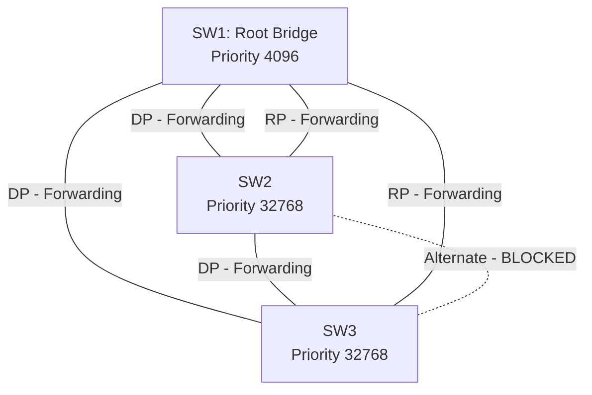

# 04. Протокол STP (Spanning Tree Protocol)

Теги: #theory #network #l2 #stp #rstp #mstp #switching #base

## Суть простыми словами
**STP (Spanning Tree Protocol — IEEE 802.1D)** — это канальный протокол ([[01. Модели OSI и TCP-IP|L2]]), который автоматически предотвращает **петли коммутации** в сетях с резервными связями между коммутаторами.

Если соединить коммутаторы в кольцо для отказоустойчивости и отключить STP, первый же широковещательный кадр (например, [[03. Коммутация, MAC, ARP и VLAN|ARP-запрос]]) будет бесконечно ходить по кругу, мгновенно «положив» всю сеть (**широковещательный шторм**). STP решает эту проблему, логически блокируя один из избыточных портов, но оставляя его в резерве на случай обрыва основного кабеля.

---

## Как работает STP: алгоритм построения дерева
Коммутаторы обмениваются специальными служебными кадрами **BPDU (Bridge Protocol Data Unit)** каждые **2 секунды** и выполняют 4 шага:

1. **Выбор корневого коммутатора (Root Bridge):** Выбирается главный свитч в сети, от которого будут строиться все пути. Побеждает коммутатор с **наименьшим значением Bridge ID (BID)**.
   * *Из чего состоит BID:* `Priority` (по умолчанию **32768**, меняется с шагом 4096) + `MAC-адрес` коммутатора. Если приоритеты одинаковые — побеждает свитч с самым маленьким MAC-адресом.
2. **Выбор корневых портов (Root Port — RP):** На каждом не-корневом коммутаторе выбирается **один** порт с наименьшей стоимостью пути (Path Cost) до Root Bridge.
   * *Типовая стоимость (Cost):* 100 Мбит/с = `19`, 1 Гбит/с = `4`, 10 Гбит/с = `2`.
3. **Выбор назначенных портов (Designated Port — DP):** На каждом сегменте (линке) между двумя коммутаторами выбирается порт, через который путь до Root Bridge дешевле. Все порты самого Root Bridge всегда являются Designated.
4. **Блокировка оставшихся портов (Blocked / Alternate Port):** Все порты, не ставшие Root или Designated, переводятся в режим блокировки (не передают пользовательский трафик, но продолжают слушать BPDU).

---

## Состояния портов и эволюция стандартов (STP, RSTP, PVST+, MSTP)
В классическом **STP (802.1D)** при обрыве кабеля переключение на резервный порт занимает **30–50 секунд**, что для современных сетей слишком долго. Поэтому в продакшене используют ускоренные версии:

* **RSTP (Rapid STP — IEEE 802.1w):** Ускоренная сходимость за **1–2 секунды** (строит одно общее дерево для всех VLAN).
* **Rapid PVST+ (Cisco):** Строит **отдельное дерево STP для каждого VLAN**. Это позволяет балансировать нагрузку (например, для VLAN 10 заблокирован левый канал, а для VLAN 20 — правый).
* **MSTP (Multiple STP — IEEE 802.1s):** Открытый стандарт, который позволяет объединять группы VLAN в несколько независимых деревьев (Instances), не нагружая процессор коммутатора при сотнях VLAN.

| Состояние в классическом STP | Состояние в RSTP | Передает трафик? | Учит MAC-адреса? | Слушает BPDU? |
| :--- | :--- | :--- | :--- | :--- |
| **Disabled** (Отключен) | **Discarding** | Нет | Нет | Нет |
| **Blocking** (Блокировка, до 20 сек) | **Discarding** | Нет | Нет | Да |
| **Listening** (Прослушивание, 15 сек) | *(Упразднено)* | Нет | Нет | Да |
| **Learning** (Обучение, 15 сек) | **Learning** | Нет | Да | Да |
| **Forwarding** (Продвижение) | **Forwarding** | **Да** | **Да** | **Да** |

---

## Обязательные функции защиты STP (Best Practices)
В реальных сетях NOC-инженер должен знать 4 ключевые настройки, без которых STP легко сломать случайным подключением или сбоем оптики:

* **PortFast (Edge Port):** Включается на портах доступа (Access), куда подключены компьютеры и серверы. Позволяет порту сразу перейти в состояние `Forwarding` без 30-секундного ожидания. *Важно: нельзя включать на портах, ведущих в другие коммутаторы!*
* **BPDU Guard:** Включается вместе с PortFast. Если в пользовательский порт кто-то по ошибке воткнет другой свитч и оттуда придет кадр BPDU — порт мгновенно уйдет в состояние ошибки (**`err-disabled`**), защищая сеть от петли.
* **Root Guard:** Ставится на порты, смотрящие в сторону периферийных или клиентских коммутаторов. Не дает подключенному извне свитчу с низким приоритетом перехватить роль **Root Bridge** и перестроить всю топологию сети.
* **Loop Guard:** Защищает от однонаправленного обрыва оптоволокна (когда трафик идет в одну сторону, а обратно нет). Если заблокированный порт перестал получать BPDU, Loop Guard переводит его в состояние **`loop-inconsistent`** (оставляет заблокированным) вместо ошибочного открытия и создания петли.

---

## Практика NOC: диагностика петель и проблем STP
* **Симптомы петли коммутации (когда STP отключен или сломан):**
  * Резкий скачок загрузки CPU на коммутаторах (до 90–100%).
  * Массовые потери пакетов (`ping` с большими задержками или обрывами), отвал управления коммутаторами.
  * Быстро мигающие индикаторы (LED) на портах свитчей.
  * В логах сыплются сообщения о **MAC Flapping** (`%SW_MATM-4-MACFLAP_NOTIF: Host ... is flapping between port Gi0/1 and Gi0/2`).
* **Как быстро локализовать петлю на дежурстве:**
  * Посмотреть загрузку интерфейсов (`show interfaces summary` или графики в Zabbix/Grafana) — на портах, участвующих в петле, будет аномально высокий широковещательный трафик (Broadcast/Multicast storm).
  * Временно выключить (`shutdown`) один из подозреваемых портов и проверить, упала ли загрузка CPU.
* **Полезные команды диагностики (Cisco / аналоги):**
  * Посмотреть текущую топологию STP, кто является Root Bridge и какие порты заблокированы: `show spanning-tree`
  * Проверить конкретный VLAN: `show spanning-tree vlan 10`
  * Найти порты, отключенные защитой (например, BPDU Guard): `show interfaces status err-disabled`

---

## Частые вопросы на собеседовании
* **Что произойдет с сетью при петле коммутации и почему она «падает»?** На уровне L2 в заголовке Ethernet-кадра нет поля **TTL** (Time To Live, как в IP-пакетах на L3). Поэтому широковещательный кадр (Broadcast) не уничтожается, а бесконечно дублируется коммутаторами, полностью забивая полосу пропускания и процессор оборудования.
* **Какой коммутатор станет Root Bridge по умолчанию, если администратор ничего не настраивал?** Коммутатор с **наименьшим MAC-адресом**, так как приоритет у всех по умолчанию одинаковый (`32768`). Обычно это самый старый свитч в сети, что очень плохо для производительности — поэтому Root Bridge всегда назначают вручную (`priority 4096`) на самом мощном ядре сети.
* **Почему порт перешел в состояние `err-disabled`?** Сработала защита порта — чаще всего **BPDU Guard** (на порт с PortFast пришел BPDU от другого свитча) или **Port Security** (превышено количество разрешенных MAC-адресов).
