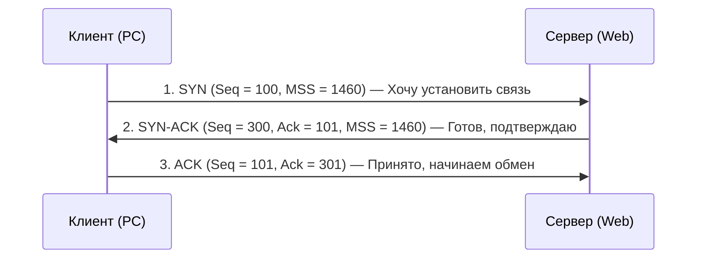

# 05. Протоколы TCP и UDP

Теги: #theory #network #l4 #tcp #udp #ports #mss #base

## Суть простыми словами
**TCP** и **UDP** — это два главных протокола транспортного уровня ([[01. Модели OSI и TCP-IP|L4]]), которые отвечают за доставку данных от конкретного приложения на одном устройстве к конкретному приложению на другом. Разделение между программами внутри одного компьютера происходит с помощью **портов** (числа от `1` до `65535`).

* **TCP (Transmission Control Protocol):** Надежная доставка с гарантией, проверкой порядка пакетов и установкой соединения (как заказное письмо с уведомлением о вручении).
* **UDP (User Datagram Protocol):** Быстрая доставка без установки соединения и без гарантии (как отправка обычных открыток — что дошло, то дошло, зато без задержек).

---

## Сравнение TCP и UDP

| Характеристика | TCP | UDP |
| :--- | :--- | :--- |
| **Установка соединения** | Да (3-way handshake перед передачей данных) | Нет (отправка сразу) |
| **Гарантия доставки** | Да (переотправка потерянных сегментов) | Нет (потерянные дейтаграммы не восстанавливаются) |
| **Порядок пакетов** | Гарантирован (сборка по номерам `Seq`) | Не гарантирован |
| **Размер заголовка** | Минимум **20 байт** (до 60 байт с опциями) | Всего **8 байт** (минимальные накладные расходы) |
| **Скорость работы** | Ниже (из-за подтверждений `ACK` и контроля потока) | Максимальная |
| **Где применяется** | Веб (HTTP/HTTPS), SSH, почта, передача файлов, BGP | Видеозвонки, стриминг, онлайн-игры, DNS, SNMP, VPN (WireGuard) |

---

## Трехстороннее рукопожатие TCP (3-Way Handshake) и флаги
Перед тем как передать первый байт данных по TCP, клиент и сервер обязаны установить сессию в 3 шага:

### Основные TCP-флаги (нужно уметь читать в tcpdump/Wireshark)
* **`SYN` (Synchronize):** Запрос на открытие нового соединения, согласование начальных номеров последовательности (`Sequence Number`) и размера сегмента (`MSS`).
* **`ACK` (Acknowledgment):** Подтверждение успешного получения данных.
* **`FIN` (Finish):** Штатное, вежливое завершение соединения со стороны отправителя (4-шаговое закрытие: `FIN` -> `ACK` -> `FIN` -> `ACK`).
* **`RST` (Reset):** Мгновенный аварийный сброс соединения. В работе NOC это важнейший индикатор: если в ответ на `SYN` прилетает `RST-ACK`, значит порт на сервере **закрыт** (сервис не запущен) или соединение сбросил файрвол.
* **`PSH` (Push):** Требование немедленно передать данные из буфера приложению, не дожидаясь заполнения буфера.

---

## Важные механизмы надежности TCP (MSS, Flow Control, Congestion Control)
* **MSS (Maximum Segment Size):** Максимальный размер полезных данных (в байтах) внутри одного TCP-сегмента без учета заголовков TCP и IP.
  * *Расчет по умолчанию:* При стандартном Ethernet [[01. Модели OSI и TCP-IP|MTU]] = `1500` байт вычитаем `20` байт IP-заголовка и `20` байт TCP-заголовка = **1460 байт**.
  * *TCP MSS Clamping:* Настройка на маршрутизаторах (особенно на туннелях VPN/PPPoE), которая принудительно уменьшает значение MSS в пакетах `SYN` (например, до `1360` байт), чтобы пакеты не превышали MTU канала и не отбрасывались.
* **Управление потоком (Flow Control / Window Size):** Механизм защиты буфера получателя. Получатель в каждом пакете сообщает отправителю свой `Window Size` (сколько байт он готов принять прямо сейчас), чтобы быстрый сервер не «завалил» медленный клиент.
* **Контроль перегрузки (Congestion Control) и ретрансмиссии:** Если в сети теряются пакеты, отправитель не получает `ACK`, считает это перегрузкой канала, снижает скорость отправки и делает повторную передачу (**TCP Retransmission**). В Wireshark массовые *TCP Retransmission* и *Duplicate ACK* — главный признак потерь на линии.

---

## Сокеты, диапазоны портов и шпаргалка по сервисам
**Сокет (Socket)** — это уникальная пара из IP-адреса и номера порта (например, `192.168.1.10:443`).
* `0 – 1023`: **Well-Known Ports** (системные порты стандартных сервисов).
* `1024 – 49151`: **Registered Ports** (зарегистрированные порты приложений и баз данных).
* `49152 – 65535`: **Dynamic / Ephemeral Ports** (временные порты, которые ОС сама выделяет клиенту при исходящем подключении).

### Таблица базовых портов для NOC-инженера

| Порт | Протокол L4 | Сервис / Протокол | Назначение |
| :--- | :--- | :--- | :--- |
| **20, 21** | TCP | FTP | Передача файлов (21 — управление, 20 — данные) |
| **22** | TCP | **SSH / SFTP** | Защищенное удаленное управление серверами и оборудованием |
| **23** | TCP | Telnet | Нешифрованное управление (устарело, небезопасно) |
| **25** | TCP | SMTP | Отправка электронной почты между серверами |
| **53** | **UDP / TCP** | **DNS** | Разрешение доменных имен (UDP — обычные запросы, TCP — передача зон и ответы >512 байт) |
| **67, 68** | UDP | **DHCP** | Автоматическая выдача IP-адресов (67 — сервер, 68 — клиент) |
| **80, 443** | TCP (и UDP для HTTP/3) | **HTTP / HTTPS** | Веб-трафик (443 использует шифрование TLS) |
| **123** | UDP | **NTP** | Синхронизация точного времени на оборудовании (критично для логов!) |
| **161, 162** | UDP | **SNMP** | Мониторинг оборудования (161 — опрос агента, 162 — прием алертов Trap) |
| **179** | TCP | **BGP** | Протокол динамической маршрутизации между автономными системами |
| **514** | UDP (или TCP) | **Syslog** | Централизованный сбор системных логов с оборудования |
| **3389** | TCP / UDP | RDP | Удаленный рабочий стол Windows |

---

## Практика NOC: диагностика проблем L4
* **Проверка доступности конкретного TCP-порта (вместо устаревшего telnet):**
  * В Linux: `nc -zv 10.10.1.5 443` (утилита Netcat).
  * В Windows (PowerShell): `Test-NetConnection -ComputerName 10.10.1.5 -Port 443`.
* **Как интерпретировать результат проверки порта:**
  * **`Connection succeeded` / `TcpTestSucceeded: True`:** Рукопожатие (`SYN -> SYN-ACK -> ACK`) прошло успешно, порт открыт, сеть в порядке.
  * **`Connection refused`:** Сервер ответил флагом **`RST`**. Сеть до сервера работает, но сам сервис (например, Nginx или SSH) на нем выключен или слушает другой порт.
  * **`Connection timed out`:** Ответ на `SYN` вообще не пришел. Пакеты либо теряются по пути, либо их молча отбрасывает (`DROP`) межсетевой экран (Firewall).
* **Просмотр открытых портов и активных сессий на Linux-сервере:**
  * `ss -tulnp` (показывает все слушающие TCP/UDP порты и процессы, которые их заняли).
* **Типичные состояния TCP-сессий в выводе `ss` / `netstat`:**
  * `LISTEN`: Сервер ждет входящих подключений на этом порту.
  * `ESTABLISHED`: Активное установленное соединение.
  * `SYN_SENT` / `SYN_RECV`: Сессия зависла на этапе рукопожатия (частый признак асимметричной маршрутизации, потери пакетов или SYN-флуда).
  * `TIME_WAIT`: Соединение закрыто, сокет ждет истечения таймера (обычно 60 сек) для отлова запоздавших пакетов в сети (нормальное состояние для высоконагруженных веб-серверов).

---

## Частые вопросы на собеседовании
* **В чем разница между MTU и MSS?** MTU (обычно 1500 байт) — это максимальный размер всего IP-пакета на L3. MSS (обычно 1460 байт) — это максимальный размер полезных данных внутри TCP-сегмента на L4 (без заголовков IP и TCP).
* **Почему DNS использует и UDP, и TCP?** Обычные DNS-запросы короткие (один запрос — один ответ), поэтому для максимальной скорости используется **UDP 53**. Но если размер ответа превышает 512 байт (или используется DNSSEC) или идет репликация зон между DNS-серверами (Zone Transfer), протокол переключается на **TCP 53**.
* **Что такое SYN-флуд (SYN Flood)?** Тип DDoS-атаки, при которой злоумышленник отправляет тысячи пакетов `SYN` с поддельных IP-адресов и не отвечает на `SYN-ACK`. Сервер забивает всю очередь полуоткрытых соединений (`SYN_RECV`) и перестает принимать легитимных пользователей.
