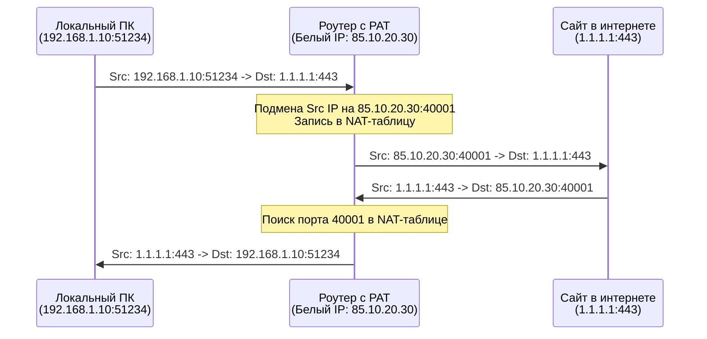

# 06. Основы маршрутизации и NAT

Теги: #theory #network #l3 #routing #nat #pat #vrrp #pbr #base

## Суть простыми словами
**Маршрутизация (Routing)** — это процесс определения наилучшего пути для передачи IP-пакетов между разными сетями на сетевом уровне ([[01. Модели OSI и TCP-IP|L3]]). Главным устройством здесь является **маршрутизатор (Router)** или **L3-коммутатор**, который принимает решения на основе своей **таблицы маршрутизации (Routing Table)**.

**NAT (Network Address Translation)** — это технология подмены IP-адресов в заголовке пакета. Она позволяет устройствам с [[02. IPv4-адресация и сабнеттинг|частными (серыми) IP-адресами]] выходить в интернет через один или несколько публичных (белых) IP-адресов.

---

## Как маршрутизатор выбирает путь (Алгоритм принятия решений)
Когда пакет приходит на интерфейс роутера, он смотрит на **IP-адрес получателя** и ищет совпадение в своей таблице маршрутизации по трем строгим правилам:

1. **Longest Prefix Match (Правило самого длинного префикса — ГЛАВНОЕ ПРАВИЛО):** Если под IP-адрес получателя подходят сразу несколько маршрутов, роутер **всегда** выберет тот, у которого **длиннее маска подсети** (более точный маршрут).
   * *Пример:* Пакет идет на `10.10.1.5`. В таблице есть `0.0.0.0/0`, `10.10.0.0/16` и `10.10.1.0/24`. Роутер выберет `/24`, так как `24 > 16 > 0`.
2. **Administrative Distance (AD — Административное расстояние):** Если есть два маршрута до **одной и той же** сети с одинаковой маской, но от разных источников (например, статический и OSPF), победит источник с **наименьшим AD** (наиболее надежный).
3. **Metric (Метрика):** Если оба маршрута получены от **одного и того же** протокола маршрутизации с одинаковой маской, победит маршрут с **наименьшей метрикой** (стоимостью пути, количеством хопов, задержкой или пропускной способностью).

### Таблица Administrative Distance (по стандарту Cisco)

| Источник маршрута (Код в таблице) | Значение AD | Надежность |
| :--- | :--- | :--- |
| **Connected (`C`)** — напрямую подключенная сеть | **0** | Максимальная |
| **Static (`S`)** — статический маршрут, заданный вручную | **1** | Очень высокая |
| **eBGP** — внешний протокол BGP | **20** | Высокая |
| **OSPF (`O`)** — внутренний протокол динамической маршрутизации | **110** | Средняя |
| **RIP (`R`)** — устаревший протокол по количеству хопов | **120** | Низкая |
| **iBGP** — внутренний протокол BGP | **200** | Низкая |
| **Unknown** — недоступный/невалидный маршрут | **255** | Не используется |

---

## Виды маршрутизации, PBR и резервирование шлюза (FHRP)
* **Directly Connected (Напрямую подключенные):** Сети, настроенные непосредственно на интерфейсах самого роутера. Появляются в таблице автоматически при поднятии интерфейса (`UP/UP`).
* **Статическая маршрутизация (Static Routing):** Маршруты прописываются вручную (`ip route 192.168.50.0 255.255.255.0 10.0.0.2`). Не нагружает CPU, но при обрыве канала не переключается сама (если не настроен трекинг **IP SLA**).
* **Маршрут по умолчанию (Default Route — `0.0.0.0/0`):** «Маршрут последней надежды» (Gateway of Last Resort). Сюда отправляется весь трафик, для которого не нашлось более точного маршрута.
* **PBR (Policy-Based Routing):** Маршрутизация на основе политик. Позволяет отправлять трафик не по IP получателя, а по **IP отправителя**, порту или протоколу (например, завернуть трафик VIP-отдела или VoIP-телефонии в отдельный резервный канал провайдера).
* **FHRP (First Hop Redundancy Protocols — VRRP / HSRP):** Протоколы резервирования шлюза по умолчанию. Два роутера объединяются в пару с общим **виртуальным IP (VIP)** и виртуальным MAC-адресом. Если основной роутер (`Master` / `Active`) выходит из строя, резервный (`Backup` / `Standby`) за пару секунд перехватывает VIP, и пользователи не замечают аварии. (Используется `Gratuitous ARP` для обновления MAC-таблиц коммутаторов).

---

## Технология NAT и ее разновидности
Без NAT интернет бы давно закончился из-за нехватки адресов IPv4. Маршрутизатор хранит специальную **таблицу трансляций (NAT Table)**, чтобы помнить, какому внутреннему компьютеру вернуть ответ из интернета.

### Основные типы и нюансы NAT
1. **Static NAT (Статический 1-к-1):** Один внутренний серый IP жестко привязан к одному внешнему белому IP. Используется для публикации корпоративных серверов в интернет.
2. **Dynamic NAT (Динамический):** Пул серых IP транслируется в пул свободных белых IP по принципу «кто первый занял». Используется редко.
3. **PAT / NAT Overload (Port Address Translation — Маскарадинг):** Самый популярный вид NAT. Тысячи внутренних устройств выходят в интернет через **один** белый IP-адрес, а роутер различает их сессии по уникальным номерам **исходящих портов (L4)**.
4. **DNAT / Port Forwarding (Проброс портов):** Входящий трафик на определенный порт внешнего белого IP перенаправляется на внутренний сервер (например, внешний `85.10.20.30:8080` -> внутренний `192.168.1.50:80`).
5. **NAT Hairpinning (NAT Loopback):** Специальное правило, позволяющее пользователям из локальной сети открывать внутренний сервер по его **внешнему белому IP** (трафик заходит на роутер и разворачивается обратно в локальную сеть).
6. **Double NAT (Двойной NAT):** Ситуация, когда трафик проходит через два маршрутизатора с NAT подряд (например, роутер абонента + CGNAT `100.64.0.0/10` у провайдера). Ломает входящий проброс портов (Port Forwarding) и некоторые типы старых VPN (IPsec без NAT-T).

---

## Практика NOC: диагностика маршрутизации и NAT
* **Петля маршрутизации (Routing Loop):** Пакет бесконечно ходит между двумя роутерами из-за неверных статических маршрутов. В отличие от L2, на уровне L3 есть защита — поле **TTL (Time To Live)** в IP-заголовке. Каждый роутер уменьшает TTL на `1`, и когда значение доходит до `0`, пакет уничтожается, а отправителю возвращается сообщение **ICMP Time Exceeded** (именно на этом принципе работает `traceroute`).
* **Асимметричная маршрутизация:** Пакет от клиента к серверу идет по одному пути (через Роутер А), а ответ возвращается по другому (через Роутер Б). Если на пути стоит Stateful Firewall или NAT, сессия разорвется, так как второй роутер не знает об открытом соединении.
* **Полезные команды диагностики:**
  * Посмотреть таблицу маршрутизации в Linux: `ip route show` (или кратко `ip r`).
  * Узнать, через какой интерфейс и шлюз Linux отправит пакет до конкретного IP: `ip route get 8.8.8.8`.
  * Посмотреть таблицу маршрутизации на Cisco: `show ip route`.
  * Проверить статус резервирования шлюза: `show vrrp brief` / `show standby brief`.
  * Посмотреть активные NAT-трансляции и проверить, не забита ли таблица: `show ip nat translations` и `show ip nat statistics` (Cisco) или `conntrack -L` (Linux).

---

## Частые вопросы на собеседовании
* **Что такое Blackhole-маршрут (Null0)?** Специальный маршрут в «никуда» (интерфейс `Null0`), который молча отбрасывает трафик. В NOC активно применяется для защиты от DDoS-атак (RTBH — Remote Triggered Black Hole) и предотвращения петель при суммировании маршрутов.
* **Почему `ping` через NAT работает, ведь у протокола ICMP нет портов?** Для ICMP-пакетов технология PAT (NAT Overload) использует вместо номера порта специальное поле **Identifier (Query ID)** внутри заголовка ICMP-запроса.
* **Что произойдет при переполнении таблицы трансляций NAT?** Новые подключения пользователей в интернет перестанут открываться, хотя уже установленные сессии продолжат работать, а сам роутер будет доступен по пингу.
