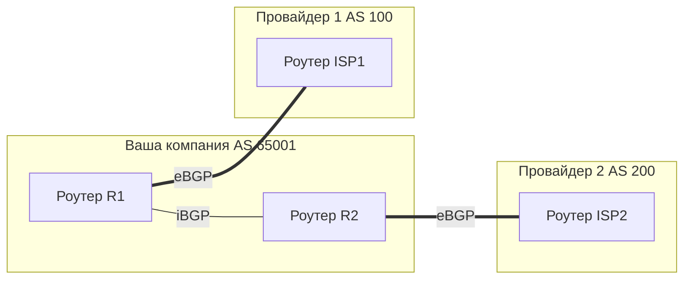

# 07. Динамическая маршрутизация (OSPF и BGP)

Теги: #theory #network #l3 #routing #ospf #bgp #dynamic #rpki #base

## Суть простыми словами
**Динамическая маршрутизация** позволяет маршрутизаторам автоматически обмениваться информацией о доступных сетях, строить карту сети и мгновенно перестраивать маршруты при обрыве кабеля или выходе из строя оборудования без участия администратора.

Все протоколы динамической маршрутизации делятся на два больших класса:
* **IGP (Interior Gateway Protocol):** Протоколы, работающие **внутри** одной организации или автономной системы (пример: **OSPF**, IS-IS). Главная цель — максимальная скорость сходимости и выбор самого быстрого канала.
* **EGP (Exterior Gateway Protocol):** Протоколы, работающие **между** разными организациями, провайдерами и автономными системами в глобальном интернете (единственный современный стандарт — **BGP**). Главная цель — гибкое управление политиками трафика и масштабируемость.

---

## Сравнение OSPF и BGP

| Характеристика | OSPF (Open Shortest Path First) | BGP (Border Gateway Protocol) |
| :--- | :--- | :--- |
| **Тип протокола** | IGP (внутри одной сети / AS) | EGP (между разными AS / провайдерами) |
| **Алгоритм работы** | Link-State (состояние каналов — алгоритм Дейкстры SPF) | Path-Vector (вектор путей по списку автономных систем) |
| **Транспорт и порт** | Работает напрямую поверх IP (**Protocol 89**), порты L4 не использует | Работает поверх **TCP (порт 179)** |
| **Поиск соседей** | Автоматически через Multicast (`224.0.0.5` и `224.0.0.6`) | Только вручную по IP-адресу соседа (Unicast) |
| **Метрика (выбор пути)** | **Cost** (стоимость, зависит от пропускной способности интерфейса) | **Атрибуты пути** (`AS-Path`, `Local Preference`, `MED`, `Weight`) |
| **Скорость сходимости** | Очень высокая (секунды или миллисекунды с BFD) | Медленная (десятки секунд, если не настроен BFD) |
| **Administrative Distance** | **110** | **20** (для внешнего eBGP) / **200** (для внутреннего iBGP) |

---

## Протокол OSPF: как устроен и почему падает соседство
В OSPF все маршрутизаторы обмениваются пакетами **LSA (Link-State Advertisement)**, собирают их в единую базу топологии (**LSDB**) и каждый сам вычисляет кратчайшее дерево путей до всех сетей.

* **Зоны (Areas):** Чтобы не перегружать процессор роутеров в больших сетях, сеть делят на зоны. Главная магистральная зона — **Area 0 (Backbone Area)**. Все остальные зоны (Area 1, Area 2...) обязаны быть подключены к Area 0.
* **Router ID (RID):** Уникальное 32-битное имя роутера в OSPF (выглядит как IPv4-адрес, например `1.1.1.1`). Выбирается вручную, либо берется максимальный IP с Loopback-интерфейса, либо с физического интерфейса.
* **DR и BDR (Designated Router / Backup DR):** В широковещательных сетях (Ethernet) роутеры выбирают «главного» (DR) и «резервного» (BDR), чтобы обмениваться маршрутами только с ними, а не каждый с каждым.

### Состояния соседства OSPF (главное состояние — `FULL`)
`Down` -> `Init` -> `2-Way` *(здесь выбираются DR/BDR)* -> `ExStart` -> `Exchange` -> `Loading` -> **`FULL`** *(базы синхронизированы, маршруты работают)*.

### 5 главных причин, почему не поднимается OSPF-соседство
Если статус застрял в `INIT` или `EXSTART`, проверьте совпадение параметров на обоих концах кабеля:
1. Не совпадает номер **Area** (например, с одной стороны `Area 0`, с другой `Area 1`).
2. Не совпадают таймеры **Hello / Dead** (по умолчанию в Ethernet `10 сек` и `40 сек`).
3. Не совпадает **маска подсети** на стыковочном интерфейсе.
4. Не совпадают настройки **аутентификации** (пароль MD5/SHA).
5. Не совпадает размер **MTU** на интерфейсах (соседство зависает в состоянии `EXSTART` / `EXCHANGE`).

---

## Протокол BGP: интернет изнутри
Весь глобальный интернет состоит из десятков тысяч независимых сетей — **Автономных Систем (AS — Autonomous System)**, каждой из которых присвоен уникальный номер (**ASN**, например, `AS15169` у Google). BGP связывает эти AS между собой.

* **eBGP (External BGP):** Сессия между роутерами из **разных** автономных систем (например, между вашей компанией и интернет-провайдером).
* **iBGP (Internal BGP):** Сессия между роутерами **внутри одной** автономной системы.
  * *Важное правило iBGP (Split Horizon):* Маршрутизатор не передает маршруты, полученные от одного iBGP-соседа, другому iBGP-соседу. Поэтому внутри одной AS роутеры либо соединяют по схеме **Full Mesh** («каждый с каждым»), либо выделяют **Route Reflector (RR)** — центральный роутер, которому разрешено переотправлять маршруты всем остальным.

### Главные атрибуты BGP (как выбирается маршрут)
В BGP нет простой метрики «скорость канала». Администратор сам управляет трафиком через атрибуты:
* **`AS-Path`:** Список номеров AS, через которые прошел маршрут. Чем короче этот список (меньше транзитных провайдеров), тем приоритетнее путь. Также служит защитой от петель: если роутер видит в `AS-Path` свой собственный номер AS, он отбрасывает маршрут. *(Для искусственного ухудшения канала делают **AS-Path Prepend** — несколько раз дублируют свой номер AS в пути).*
* **`Local Preference` (Local Pref):** Управляет **исходящим** трафиком из вашей AS (чем больше значение, тем выше приоритет; по умолчанию `100`).
* **`MED` (Multi-Exit Discriminator):** Подсказывает соседнему провайдеру, через какой из двух каналов лучше отправлять **входящий** трафик в вашу сеть (чем меньше значение, тем лучше).

### Состояния сессии BGP (главное состояние — `Established`)
`Idle` -> `Connect` -> `Active` -> `OpenSent` -> `OpenConfirm` -> **`Established`** *(сессия работает, идет обмен префиксами)*.

---

## Безопасность и стабильность в BGP (RPKI, Route Leak, Graceful Restart)
* **Route Leak и BGP Hijacking:** Ошибка конфигурации (или атака), когда один провайдер начинает анонсировать в мир чужие IP-сети, перехватывая или «роняя» трафик. В интернете не принимаются маршруты с маской длиннее **`/24`** (все префиксы `/25`–`/32` в глобальном BGP отбрасываются).
* **Фильтрация и RPKI (Resource Public Key Infrastructure):** Чтобы защититься от неверных анонсов, операторы используют списки фильтрации (**Prefix-List** и **AS-Path Filter**) и криптографическую систему **RPKI**, которая проверяет по базе данных (ROA), имеет ли данная AS законное право анонсировать конкретную подсеть.
* **Graceful Restart (GR):** Механизм, позволяющий роутеру не прерывать передачу пакетов (Data Plane) в течение 1–2 минут во время перезагрузки процесса BGP/OSPF (Control Plane).

---

## Практика NOC: диагностика OSPF и BGP
* **Если в BGP статус `Active` или `Idle`:** Это **НЕ** значит, что сессия работает! Наоборот, статус `Active` означает, что роутер активно пытается достучаться до соседа по TCP 179, но не может (проблема с физическим линком, неверный IP соседа, неверный номер AS или блокировка порта 179 файрволом). Рабочее состояние одно — **`Established`**.
* **Что такое BGP Flap (Флаппинг сессии):** Постоянное падение и поднятие BGP-сессии. Очень опасно, так как заставляет роутеры по всему миру пересчитывать маршруты (провайдеры могут временно заблокировать такой нестабильный маршрут функцией *Route Dampening*).
* **Полезные команды диагностики (Cisco / FRR Linux):**
  * Проверить соседей OSPF (должно быть `FULL`): `show ip ospf neighbor`
  * Проверить все BGP-сессии и количество принятых маршрутов: `show ip bgp summary` (в столбце `State/PfxRcd` должно стоять **число** принятых префиксов, а не слово `Active` или `Idle`).
  * Посмотреть конкретные маршруты, полученные по BGP: `show ip bgp`

---

## Частые вопросы на собеседовании
* **В чем главная разница между OSPF и BGP?** OSPF (IGP) работает внутри одной организации, строит полную карту топологии и ищет самый быстрый канал по скорости линков. BGP (EGP) связывает разные организации и провайдеров, не знает внутренней топологии соседей и выбирает маршрут по административным политикам и количеству автономных систем (`AS-Path`).
* **Что такое BFD (Bidirectional Forwarding Detection)?** Сверхбыстрый протокол обнаружения обрыва связи (работает за миллисекунды), который привязывают к OSPF или BGP, чтобы не ждать 30–180 секунд стандартных таймеров при падении канала.
* **Что такое Full View в BGP?** Полная таблица маршрутизации всего мирового интернета (более 950 000+ префиксов IPv4), которую принимают крупные операторы связи и компании с несколькими провайдерами для выбора оптимального маршрута до любой точки мира.
