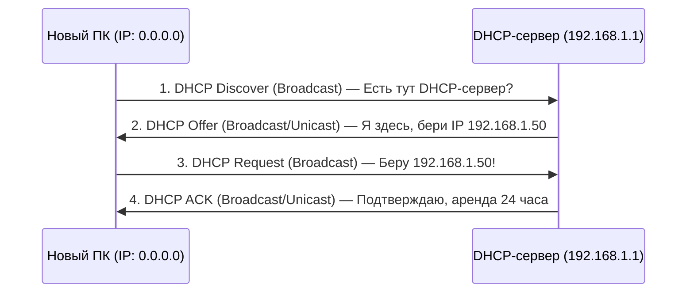

# 08. Сервисы DNS и DHCP

Теги: #theory #network #l7 #dns #dhcp #dora #dnssec #base

## Суть простыми словами
**DHCP (Dynamic Host Configuration Protocol)** — протокол, который автоматически выдает устройствам в сети [[02. IPv4-адресация и сабнеттинг|IP-адрес]], маску подсети, шлюз по умолчанию и адреса DNS-серверов при подключении к сети.

**DNS (Domain Name System)** — распределенная «телефонная книга» интернета, которая переводит понятные человеку доменные имена (например, `google.com`) в IP-адреса (`142.250.74.46`) и обратно.

---

## Протокол DHCP: процесс DORA и важные механизмы
DHCP работает на прикладном уровне ([[01. Модели OSI и TCP-IP|L7]]) поверх **UDP** (порт **67** — сервер, порт **68** — клиент). Получение адреса происходит в **4 этапа (DORA)**:

### Важные понятия и опции в работе DHCP
* **Lease Time (Время аренды):** Срок, на который выдается IP-адрес. По истечении **50% срока (таймер T1)** клиент пытается продлить адрес у того же сервера (Unicast `DHCP Request`). Если сервер не отвечает, на **87.5% срока (таймер T2)** клиент рассылает запрос всем серверам в сети (Broadcast).
* **Static Lease (Резервирование по MAC):** Привязка конкретного IP-адреса к MAC-адресу устройства на стороне DHCP-сервера (используется для принтеров, камер, серверов, чтобы их IP не менялся, но управлялся централизованно).
* **Основные опции DHCP (DHCP Options):** Дополнительные параметры, передаваемые в пакете `Offer`/`ACK`:
  * **Option 3:** Шлюз по умолчанию (Default Gateway).
  * **Option 6:** Адреса DNS-серверов.
  * **Option 15:** Суффикс локального домена (например, `corp.local`).
  * **Option 43 / 66 / 150:** Служебные опции для автоматической настройки Wi-Fi точек доступа (адрес контроллера) и IP-телефонов (TFTP-сервер).
* **DHCP Relay (IP Helper):** Так как первый пакет `Discover` является широковещательным (Broadcast), маршрутизаторы по умолчанию его не пропускают в другие сети. Если DHCP-сервер стоит в другом VLAN или дата-центре, на роутере/L3-коммутаторе включают функцию **DHCP Relay** (`ip helper-address`), которая превращает Broadcast-запрос клиента в обычный Unicast-пакет и пересылает его на центральный DHCP-сервер.
* **DHCP Snooping (Защита от поддельных серверов):** Функция безопасности на коммутаторах L2. Администратор помечает порт реального сервера как **Trusted**, а все клиентские порты как **Untrusted**. Если пользователь по ошибке воткнет свой домашний роутер в офисную розетку, коммутатор заблокирует его ответы `DHCP Offer` и не даст положить сеть.

---

## Система DNS: как происходит поиск IP-адреса
Классический DNS работает поверх **UDP 53** (обычные короткие запросы) и **TCP 53** (передача зон между серверами и большие ответы > 512 байт / DNSSEC).

### Иерархия и пошаговый алгоритм разрешения имени (на примере `://example.com`)
1. **Локальный кэш и файл `hosts`:** Компьютер сначала проверяет свой кэш DNS и локальный текстовый файл (`C:\Windows\System32\drivers\etc\hosts` в Windows или `/etc/hosts` в Linux).
2. **Рекурсивный резолвер (DNS-сервер провайдера или `8.8.8.8` / `1.1.1.1`):** Если в кэше пусто, ПК спрашивает свой настроенный DNS-сервер, который берет на себя всю работу по поиску.
3. **Корневые серверы (Root Servers — `.`):** Резолвер идет к корневому серверу, который отвечает: «Я не знаю IP `://example.com`, но за зону `.com` отвечают вот эти TLD-серверы».
4. **Серверы доменов верхнего уровня (TLD — `.com`, `.by`, `.ru`):** TLD-сервер отвечает: «За домен `example.com` отвечают авторитативные NS-серверы компании (`://example.com`)».
5. **Авторитативный DNS-сервер (Authoritative NS):** Хранит реальные записи домена и возвращает точный IP-адрес для `://example.com`, который кэшируется на время **TTL**.

---

## Основные типы DNS-записей и коды ответов

| Тип записи | Расшифровка | Назначение и пример |
| :--- | :--- | :--- |
| **`A`** | Address (IPv4) | Связывает домен с **IPv4-адресом** (`example.com` -> `93.184.216.34`) |
| **`AAAA`** | IPv6 Address | Связывает домен с **IPv6-адресом** (`example.com` -> `2606:2800:220:1:...`) |
| **`CNAME`** | Canonical Name | Псевдоним (алиас) одного домена на другой (`://example.com` -> `example.com`). *Нельзя ставить на корневой домен!* |
| **`MX`** | Mail Exchange | Указывает серверы для приема электронной почты с приоритетом (`10 ://example.com`) |
| **`NS`** | Name Server | Указывает авторитативные DNS-серверы, управляющие данной зоной |
| **`PTR`** | Pointer (Обратная запись) | Обратное преобразование **IP-адреса в доменное имя** (зона `in-addr.arpa`). Критично для почтовых серверов и диагностики (`traceroute`) |
| **`TXT`** | Text Record | Произвольный текст. Используется для подтверждения владения доменом и защиты почты от спама (**SPF, DKIM, DMARC**) |
| **`SOA`** | Start of Authority | Техническая запись с информацией о зоне: главный сервер, почта админа и таймеры обновления |

### Главные статусы ответов DNS (RCODE в выводе `dig`)
* **`NOERROR`:** Запрос выполнен успешно, запись найдена.
* **`NXDOMAIN` (Non-Existent Domain):** Доменное имя не существует (опечатка в адресе или запись еще не создана).
* **`SERVFAIL` (Server Failure):** Внутренняя ошибка DNS-сервера (авторитативный сервер недоступен, сломалась зона или не прошла проверка криптоподписи **DNSSEC**).
* **`REFUSED`:** DNS-сервер отклонил запрос по правилам безопасности (например, запрещена рекурсия для внешних клиентов).

### Безопасность и архитектура DNS
* **TTL (Time To Live в DNS):** Время (в секундах), которое DNS-резолверы имеют право хранить запись в кэше. Перед переездом сайта на новый IP-адрес администраторы заранее снижают TTL с `3600` (1 час) до `60` (1 минута), чтобы переключение прошло без долгого простоя.
* **Split-Horizon DNS (Расщепленный DNS):** Настройка, при которой один и тот же домен (например, `://company.com`) возвращает пользователям внутри офиса **серый локальный IP** (`10.10.1.50`), а внешним пользователям из интернета — **белый публичный IP** (`85.10.20.30`).
* **DNSSEC:** Расширение безопасности, добавляющее цифровые подписи (записи `RRSIG`, `DNSKEY`), чтобы защитить пользователей от подмены DNS-ответов (DNS Spoofing).
* **DoT и DoH:** Шифрование DNS-трафика от клиента до резолвера — **DoT (DNS over TLS, порт TCP 853)** и **DoH (DNS over HTTPS, порт TCP 443)**.

---

## Практика NOC: диагностика проблем DHCP и DNS
* **Симптом «Интернет не работает, но пинг до `8.8.8.8` идет»:** Классическая авария DNS. Сеть (L1–L3) работает, но сломался DNS-сервер или заблокирован порт `UDP 53`.
  * *Проверка:* `dig google.com` или `nslookup google.com 8.8.8.8`. Если через `8.8.8.8` отвечает, а через локальный DNS нет — проблема в корпоративном DNS-сервере.
* **Симптом «Устройство получило IP `169.254.x.x` (APIPA)»:** Клиент отправил `DHCP Discover`, но не получил `DHCP Offer`.
  * *Причины:* Закончился пул свободных IP-адресов на сервере, упала служба DHCP, не настроен `ip helper-address` (DHCP Relay) на роутере, порт заблокирован функцией `DHCP Snooping` или неверный VLAN на порту.
* **Полезные команды диагностики:**
  * Сбросить и заново запросить IP по DHCP в Windows: `ipconfig /release` -> `ipconfig /renew`
  * Посмотреть полную трассировку DNS-запроса от корневых серверов (Linux): `dig +trace example.com`
  * Проверить конкретный тип записи (например, почтовые MX): `dig example.com MX +short`
  * Проверить обратную запись (PTR) по IP-адресу: `dig -x 8.8.8.8 +short`
  * Очистить локальный кэш DNS в Windows: `ipconfig /flushdns`

---

## Частые вопросы на собеседовании
* **Что такое Rogue DHCP Server и как с ним бороться?** Это несанкционированный DHCP-сервер в сети (например, сотрудник воткнул домашний роутер LAN-портом в офисную сеть), который начинает раздавать клиентам левые IP и себя в качестве шлюза, перехватывая трафик. Лечится включением **DHCP Snooping** на коммутаторах доступа.
* **В чем разница между рекурсивным и итеративным DNS-запросом?** При **рекурсивном** запросе (клиент -> резолвер) сервер обязан сам обойти все инстанции и вернуть готовый конечный IP (или ошибку). При **итеративном** запросе (резолвер -> корневой/TLD сервер) сервер отвечает тем, что знает сам («спроси вот у того сервера»).
* **Зачем нужна PTR-запись и где она используется?** Для превращения IP обратно в имя (Reverse DNS). В NOC она сразу показывает имена узлов в выводе `mtr` / `traceroute` (например, `msk-core-r1.isp.net`), а также строго проверяется почтовыми серверами для защиты от спама.
