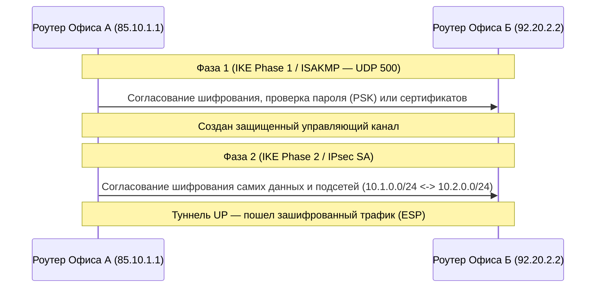

# 09. Туннели и VPN (GRE, IPsec, WireGuard)

Теги: #theory #network #l3 #vpn #tunnel #gre #ipsec #wireguard #mtu #base

## Суть простыми словами
**VPN (Virtual Private Network)** и **сетевые туннели** — это технологии, которые позволяют создать защищенный виртуальный «мост» между двумя офисами (Site-to-Site) или удаленным сотрудником и офисом (Remote Access) поверх обычного незащищенного интернета.

Главная идея туннелирования — **инкапсуляция** (пакет в пакете): исходный локальный IP-пакет (с серыми адресами офиса) упаковывается внутрь нового внешнего IP-пакета (с публичными белыми адресами маршрутизаторов), а при использовании шифрования содержимое еще и зашифровывается.

---

## Сравнение основных технологий: GRE, IPsec и WireGuard

| Характеристика | GRE (Generic Routing Encapsulation) | IPsec (Internet Protocol Security) | WireGuard |
| :--- | :--- | :--- | :--- |
| **Наличие шифрования** | **Нет** (передает данные в открытом виде) | **Да** (сильное шифрование AES/ChaCha20) | **Да** (современная криптография ChaCha20) |
| **Протоколы и порты** | IP Protocol **47** (без портов L4) | **UDP 500** (IKE), **UDP 4500** (NAT-T), **ESP** (Protocol 50) | **UDP** (любой порт, по умолчанию **51820**) |
| **Передача Multicast / OSPF** | **Да** (главный плюс GRE) | Только в режиме **VTI** (Route-based) или через GRE | Нет (только Unicast L3, но можно обернуть) |
| **Работа через NAT** | Плохо (нет портов L4, нужен спец. ALG на роутере) | Работает через **NAT-T** (UDP 4500) | **Отлично** (легко пробивает любой NAT) |
| **Скорость и нагрузка на CPU** | Очень высокая скорость (нет шифрования) | Средняя (высокие накладные расходы) | **Максимальная** (работает в ядре Linux) |
| **Где применяется** | Связка **GRE over IPsec** для запуска [[07. Динамическая маршрутизация (OSPF и BGP)|OSPF/BGP]] между офисами | Классический корпоративный стандарт (Cisco, MikroTik, Huawei, FortiGate) | Современные VPN, Linux-серверы, облака, мобильные клиенты |

---

## Как устроен IPsec: 2 фазы, IKEv1/IKEv2 и режимы работы
**IPsec** — это не один протокол, а целый набор стандартов. Чтобы туннель поднялся, маршрутизаторы проходят **2 фазы (IKE — Internet Key Exchange)**:

### Основные протоколы и версии IPsec
* **IKEv1 vs IKEv2:** *IKEv1* — устаревший стандарт (работает медленнее, имеет два режима — тяжелый *Main Mode* и менее безопасный *Aggressive Mode*). **IKEv2** — современный стандарт: быстрее устанавливает сессию (меньше пакетов), нативно поддерживает NAT-T и технологию **MOBIKE** (туннель не рвется при переключении смартфона с Wi-Fi на мобильный интернет).
* **AH (Authentication Header — IP Protocol 51):** Проверяет только целостность и подлинность пакета, но **не шифрует** данные. Конфликтует с NAT, поэтому почти не используется.
* **ESP (Encapsulating Security Payload — IP Protocol 50):** Главный рабочий протокол IPsec. Обеспечивает и **шифрование**, и проверку целостности.

### Архитектура туннелей: Policy-based vs Route-based (VTI)
* **Policy-based VPN (Классический IPsec по ACL):** Шифруется только тот трафик, который попадает под жестко заданные списки доступа (Crypto ACL / Encryption Domain). Сложно масштабировать и нельзя напрямую запустить OSPF/BGP.
* **Route-based VPN (VTI — Virtual Tunnel Interface):** На роутере создается виртуальный сетевой интерфейс (как в WireGuard или GRE), а трафик направляется в него обычными статическими или динамическими маршрутами (`0.0.0.0/0` или OSPF/BGP). Современный стандарт в корпоративных сетях.
* **GRE over IPsec:** Популярная связка для старого оборудования: сначала строится интерфейс `GRE` (чтобы ходил Multicast для OSPF), а затем весь GRE-трафик шифруется через IPsec в транспортном режиме.

---

## Контроль жизни туннеля и маршрутизация клиентов
* **DPD (Dead Peer Detection в IPsec):** Механизм проверки «живучести» удаленного роутера. Если от соседа давно не было трафика, роутер шлет проверочные пакеты `R-U-THERE`. Если ответа нет — туннель принудительно гасится, чтобы трафик переключился на резервный канал.
* **PersistentKeepalive (в WireGuard):** Специальный таймер (обычно `25 секунд`), который заставляет клиента за NAT регулярно отправлять пустой UDP-пакет на сервер, чтобы домашний роутер не закрыл трансляцию в своей NAT-таблице.
* **Split Tunneling vs Full Tunnel (для удаленных сотрудников):**
  * **Split Tunneling (Раздельное туннелирование):** В VPN-туннель идет только трафик до рабочих серверов компании, а обычный интернет (поиск, видео, мессенджеры) идет напрямую через провайдера сотрудника (экономит канал офиса).
  * **Full Tunnel (Полное туннелирование):** Весь трафик сотрудника (`0.0.0.0/0`) заворачивается в корпоративный VPN для максимальной безопасности и фильтрации.

---

## Главная боль NOC в туннелях: MTU, MSS и фрагментация
Любой туннель добавляет к пакету свой дополнительный заголовок (overhead):
* **GRE:** добавляет **24 байта** (20 байт новый IP + 4 байта GRE).
* **IPsec (ESP):** добавляет **50–60 байт**.
* **WireGuard:** добавляет **60–80 байт** (в зависимости от IPv4/IPv6).

Если стандартный Ethernet [[01. Модели OSI и TCP-IP|MTU]] равен **1500 байт**, то после добавления заголовков туннеля общий размер пакета превышает 1500 байт.

### Симптом и решение (Классика на собеседовании)
* **Симптом:** Туннель поднялся, `ping` между офисами идет идеально, по SSH зайти можно, но тяжелые сайты, 1С, RDP или передача файлов «зависают» намертво.
* **Причина:** Маленькие пакеты (пинг 64 байта) свободно пролезают в туннель, а большие пакеты (1500 байт) с флагом **DF (Don't Fragment)** отбрасываются роутером, если не работает **PMTUD** (Path MTU Discovery, часто ломается из-за блокировки ICMP).
* **Решение:**
  1. Уменьшить `MTU` на виртуальном туннельном интерфейсе (например, поставить `mtu 1400` или `1380`).
  2. Настроить **TCP MSS Clamping** (`ip tcp adjust-mss 1360`), чтобы маршрутизатор сам подрезал размер сегмента в пакетах `SYN` при установке TCP-соединения.

---

## Практика NOC: диагностика падения VPN-туннелей
* **Туннель не поднимается (застрял на Фазе 1 или Фазе 2):**
  * **Фаза 1 не проходит:** Не совпадает общий ключ (Pre-Shared Key — PSK), не совпадают алгоритмы шифрования/хеширования (например, AES-256 vs AES-128, SHA256 vs SHA1), провайдер блокирует `UDP 500 / 4500`, либо один из роутеров находится за NAT, а функция **NAT-T (NAT Traversal)** отключена.
  * **Фаза 1 прошла, но Фаза 2 падает:** Не совпадают **Encryption Domains (Proxy IDs)** — то есть списки подсетей, которые должны шифроваться (например, на Офисе А указана сеть `10.1.0.0/24`, а на Офисе Б — `10.1.0.0/16`).
* **Туннель «спит» (Idle), пока нет трафика:**
  * Многие Policy-based IPsec-туннели поднимаются только по появлению интересного трафика. Если пинг не идет, попробуйте запустить пинг именно **из внутренней локальной сети** (`ping 10.2.0.1 source 10.1.0.1`), а не с внешнего белого IP роутера!
* **Полезные команды диагностики:**
  * Проверка Фазы 1 IPsec (Cisco): `show crypto isakmp sa` (рабочий статус — `QM_IDLE`).
  * Проверка Фазы 2 IPsec и счетчиков зашифрованных/расшифрованных пакетов (`#pkts encaps` / `#pkts decaps`): `show crypto ipsec sa`.
  * Проверка статуса WireGuard в Linux: `wg show` (смотреть на поле `latest handshake` — если рукопожатие было больше 3 минут назад, туннель отвалился).
  * Проверка MTU канала без фрагментации:
    * Linux: `ping -M do -s 1472 10.2.0.1` (1472 + 28 байт заголовков IP/ICMP = 1500).
    * Windows: `ping -f -l 1472 10.2.0.1`.

---

## Частые вопросы на собеседовании
* **В чем разница между Site-to-Site VPN и Remote Access VPN?** *Site-to-Site* соединяет две целые офисные сети через их граничные маршрутизаторы (пользователям не нужно ставить VPN-клиент на ПК). *Remote Access* соединяет одиночного удаленного сотрудника (ноутбук/смартфон) с корпоративной сетью (OpenVPN, WireGuard, Cisco AnyConnect).
* **Зачем нужен NAT-T (NAT Traversal) в IPsec?** Оригинальный протокол ESP (Protocol 50) не имеет портов TCP/UDP, поэтому обычный NAT-маршрутизатор не может корректно транслировать несколько IPsec-сессий. NAT-T «заворачивает» ESP-пакеты внутрь обычного **UDP-пакета на порт 4500**, чтобы они без проблем проходили через любые NAT-роутеры.
* **Почему при диагностике VPN-туннеля обязательно проверяют NAT-правила на роутере?** Частая ошибка инженеров: пакеты в удаленный офис попадают под общее правило **NAT Overload (Masquerade)** для выхода в интернет раньше, чем попадают в туннель. Чтобы этого не было, для трафика между офисами настраивают правило **NAT Exemption (No-NAT)**.
