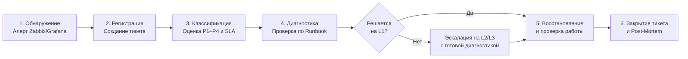

# 14. Жизненный цикл инцидента (ITIL и регламенты NOC)

Теги: #theory #noc #itil #incident #sla #mttr #escalation #postmortem #base

## Суть простыми словами
**NOC (Network Operations Center)** — это центр мониторинга и оперативного управления сетью, работающий в режиме 24/7. Главная задача инженера NOC (обычно 1-я линия, L1) — **немедленно обнаружить сбой, локализовать его, восстановить работу сервиса** (по инструкции или через перезапуск/переключение на резерв) и, если проблема требует глубокого вмешательства, **грамотно эскалировать** ее на профильных инженеров (L2/L3).

---

## Базовая терминология ITIL и ключевые метрики (Обязательно знать!)

| Термин | Определение простыми словами | Пример из практики NOC |
| :--- | :--- | :--- |
| **Incident (Инцидент)** | Любое незапланированное прерывание или снижение качества работы сервиса. **Главная цель:** как можно быстрее вернуть сервис в строй (даже временным «костылем»). | Упал BGP-канал основного провайдера, трафик переключили на резервный канал — инцидент решен. |
| **Workaround (Обходное решение)** | Временное решение, которое восстанавливает работу сервиса без устранения самой причины поломки. | Перезапуск зависшего сервиса Nginx или переключение трафика на резервный сервер. |
| **Problem (Проблема)** | Глубинная первопричина (Root Cause) одного или нескольких повторяющихся инцидентов. | Выяснение того, почему Nginx падал каждую ночь (утечка памяти в коде или нехватка места на диске). |
| **Change (Изменение)** | Любое запланированное добавление, изменение или удаление чего-либо в инфраструктуре (RFC — Request for Change). | Ночное обновление прошивки коммутатора или смена правил файрвола. |
| **SLA (Service Level Agreement)** | Соглашение об уровне сервиса с клиентом или бизнесом (гарантированное время реакции, время восстановления и процент доступности). | Реакция на критический алерт — не более **15 минут**, время восстановления — не более **2 часов**. |

### Главные метрики надежности и реакции NOC
* **MTTD (Mean Time To Detect):** Среднее время обнаружения сбоя (от момента поломки до срабатывания алерта и взятия его в работу).
* **MTTR (Mean Time To Resolve / Recover):** Среднее время полного восстановления сервиса (главный показатель эффективности работы NOC).
* **MTBF (Mean Time Between Failures):** Среднее время безотказной работы оборудования или канала между поломками.

### Шпаргалка по «девяткам» доступности SLA
* **`99.9%` («три девятки»):** Допустимый простой — до **43.8 минут в месяц** (~8.76 часов в год).
* **`99.95%`:** Допустимый простой — до **21.9 минут в месяц** (~4.38 часов в год).
* **`99.99%` («четыре девятки»):** Допустимый простой — до **4.38 минут в месяц** (~52.6 минут в год).

---

## Матрица приоритетов инцидентов (Impact × Urgency = Priority)
Приоритет тикета в NOC определяется двумя факторами: **Влиянием на бизнес (Impact)** и **Срочностью (Urgency)**:

| Приоритет | Уровень критичности | Описание ситуации | Регламент действий NOC |
| :--- | :--- | :--- | :--- |
| **P1 (Critical)** | **Blocker / Авария** | Полностью недоступен критичный сервис для всех пользователей, упал дата-центр или магистральный канал. | Немедленная реакция (до 5–15 мин), звонок дежурному инженеру L2/L3 и уведомление руководства. |
| **P2 (High)** | **Серьезная деградация** | Сервис работает с большими задержками/потерями пакетов, упал один из двух резервных каналов (резерва больше нет). | Взять в работу в течение 15–30 мин, диагностика и эскалация на L2. |
| **P3 (Medium)** | **Умеренное влияние** | Сбой у одного пользователя или некритичного внутреннего сервиса, есть обходное решение. | Взять в работу в течение 1–2 часов, решение в плановом порядке. |
| **P4 (Low)** | **Низкий приоритет** | Косметические ошибки, информационные запросы, плановые задачи. | Решается в рабочее время без срочности. |

---

## Жизненный цикл инцидента (6 шагов дежурного NOC)

---

## Золотые правила эскалации и передачи смены (Shift Handover)
Главная ошибка новичков в NOC — перекинуть тикет на старших инженеров со словами *«Там что-то не работает, посмотрите»*. При эскалации тикет обязан содержать:

1. **Четкое описание симптомов:** Что именно сломалось, кого затронуло и во сколько началось (точное время с привязкой к часовому поясу, например `UTC+3`).
2. **Что уже проверено (результаты диагностики):** Вывод команд (`ping`, `mtr`, `curl`, `ss`, статус портов или BGP-сессий), ссылки на графики в Grafana/Zabbix за период сбоя.
3. **Связь с недавними изменениями:** Проводились ли в это время плановые работы (Maintenance) или обновления.
4. **Номер внешнего тикета (если авария у провайдера):** Если проблема на стороне вышестоящего оператора связи, инженер NOC сначала сам открывает тикет у провайдера (приложив `mtr`), и только потом передает информацию дальше.

### Чек-лист передачи смены (Shift Handover)
Перед уходом со смены дежурный инженер обязан передать сменщику:
* Список всех **активных незакрытых инцидентов** (статус, на ком висит, когда последний раз обновляли информацию для клиента).
* Список **запланированных работ (Maintenance Windows)** на ближайшие 12 часов (чтобы сменщик не испугался планового отключения оборудования).
* Информацию о **«моргающих» (flapping) каналах** или временных обходных решениях (Workarounds), которые нужно вернуть в штатный режим.

---

## Post-Mortem и правила безопасности в продакшене
После устранения серьезного инцидента (P1/P2) команда проводит **Blameless Post-Mortem** (разбор без поиска виноватых людей — ищем уязвимости в системе, а не «крайнего» сотрудника). В документ записывают:
* **Timeline (Хронология):** Поминутная лента событий (когда пришел алерт, когда начали диагностику, когда переключили трафик, когда сервис ожил).
* **Root Cause (Первопричина):** Техническая причина сбоя.
* **Action Items (План улучшений):** Конкретные задачи, чтобы авария не повторилась (например: добавить новый триггер в Zabbix, написать новый Runbook, настроить резервный канал).

> **Главные табу инженера NOC:**
> * **Никаких изменений без плана отката (Rollback Plan)** и резервной копии конфигурации (`backup`).
> * **Read-Only Friday (Пятница — день тишины):** Любые несрочные изменения в сети и на серверах запрещены перед выходными.

---

## Частые вопросы на собеседовании
* **Пришло сразу 20 критических алертов: упал сайт, база данных, почта и 15 коммутаторов в филиале. За что схватитесь в первую очередь?** Сначала нужно найти **корень дерева (корневой узел)** — скорее всего, упал пограничный маршрутизатор или магистральный канал до филиала, а остальные 19 алертов — это лишь следствие потери связи с ним. Проверяем связь до граничного роутера.
* **Что такое «правило 15 минут» при диагностике в NOC?** Если инженер L1 в течение 15 минут не может понять причину критического инцидента (P1) или не имеет прав доступа для его устранения, он **обязан** немедленно эскалировать задачу на L2/L3, а не пытаться героически разбираться в одиночку, срывая SLA.
* **В чем разница между горизонтальной и вертикальной эскалацией?** *Горизонтальная (функциональная)* — передача задачи более узкому специалисту (например, от сетевого инженера к администратору баз данных или провайдеру). *Вертикальная (иерархическая)* — уведомление руководства, менеджеров и бизнес-заказчиков при угрозе срыва SLA или масштабной аварии.
